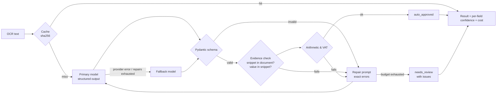

# ai-invoice-extractor

[](https://github.com/ndanetaadmire-debug/ai-invoice-extractor/actions/workflows/ci.yml)


**LLM invoice extraction you can put in front of an accounts team.** It turns OCR text into validated structured data, and refuses to auto-approve anything it can't verify against the document itself.

The hard part of LLM extraction isn't getting JSON out; it's knowing when the JSON is wrong. Models invent plausible totals, transpose digits and "fix" arithmetic the supplier got wrong. This service treats every model output as a **claim** and checks it.

## How a document flows



| Control | What it catches |
|---|---|
| **Pydantic schema** (`extra="forbid"`, Decimal money, SA VAT-number format) | Malformed output, wrong types, invented fields |
| **Evidence spans**: each key field carries the verbatim snippet it was read from; the snippet must occur in the document and contain the value | **Hallucinated values.** A total of R9,050 "read" from a document that says R8,050 fails here |
| **Arithmetic**: subtotal + VAT = total, VAT = 15%, line items sum, qty × price | Misreads, and supplier errors a human should see |
| **Bounded repair loop**: exact validation and verification errors are fed back | Most first-pass mistakes, fixed for the cost of one more call |
| **Model fallback chain**: provider errors or exhausted repairs move to the next model; a deterministic rules model is the zero-cost last resort | Outages, rate limits |
| **Verification-based confidence**: per field, from the checks rather than the model's self-report | Overconfident models |
| **Content-hash cache** | Paying twice for the same document |
| **Cost tracking** per document, per model | Budget surprises |

Only results with **no blocking issues** are `auto_approved`. Everything else is `needs_review` with a precise list of what failed, ready for a human queue (see [finance-workflow-engine](https://github.com/ndanetaadmire-debug/finance-workflow-engine)).

## Accuracy is measured, not assumed

`data/` holds labelled invoices in deliberately different layouts: `R 12 000,00` vs `R12,000.00`, `03/11/2026` vs `28 October 2026`, "Amount due" vs "Balance due" vs "Total incl VAT", with and without line items and VAT numbers.

```
$ invx eval
field accuracy 100.0% · auto-approved 100%
```

CI fails below 95% field accuracy, so a prompt tweak or model swap that quietly breaks dates or amounts is caught before it ships. Swap in your own labelled set from production samples.

## Tests

Scripted fake models drive the real pipeline: invalid JSON then repair, schema errors fed back verbatim, a **hallucinated total caught by the evidence check and corrected**, persistent errors routed to review (never auto-approved), provider outage → fallback, cache hit costs nothing, cost accounting, size limits.

```bash
pip install -e ".[dev]"
invx extract data/invoices/karoo.txt
invx eval
LLM_API_KEY=sk-... LLM_MODEL=gpt-4.1-mini invx extract invoice.txt     # real model, rules model as fallback
uvicorn invx.api:create_app --factory                                 # POST /extract
pytest --cov && mypy && ruff check src tests
```

---

Built by **[Admire T. Ndaneta](https://admire-portfolio.vercel.app)**. MIT licensed.
